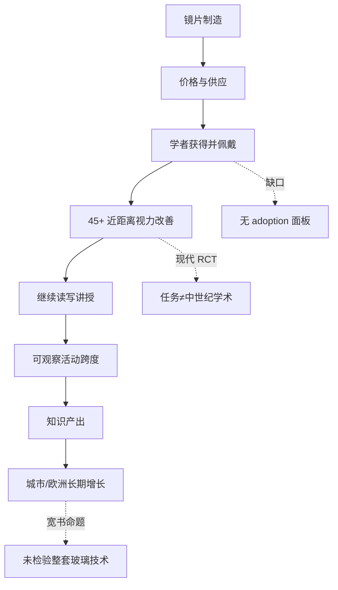

# 文献综述要点与因果图（DAG）

## A. 眼镜史核心文献（简表）

| 主题 | 文献 | 本项目取用 |
|------|------|------------|
| 发明约 1286、意大利 | Rosen (1956); Ilardi (2007) *Renaissance Vision from Spectacles to Telescopes* | 时点先验；城市分类参考 |
| 扩散、制造、贸易、学者与工匠用途 | Ilardi (2007)；佛罗伦萨 15 世纪订购信等 | **支持功能史**；不自动证明职业延长或文明因果 |
| 玻璃文明宽叙事 | Macfarlane & Martin (2002) | 主张谱系上游（见 `CLAIM_GENEALOGY.md`） |
| 手稿/印本宏观 | Buringh & van Zanden | 时点相容检验 |
| 学者/城市 HC | RETE / CDMV (de la Croix et al.) | 面板关联 |
| 现代老花矫正 RCT | PROSPER / PROSPER II / THRIVE | 机制类比（任务不匹配） |

### Ilardi 要点（与窄命题的关系）

- 发明：约 1286，意大利（比萨一带常见说法）；1306 年 Giordano da Pisa 布道可作旁证。
- 功能：便利学者文本工作与工匠近距离劳动。
- **不蕴含**：职业生涯系统性延长 → 城市知识优势 → 科学革命/文明起点。
- 采用率、价格、佩戴依从、学者拥有率：史料碎片化；**本项目无直接 adoption/use 面板**。

链条中间「获得并实际佩戴」是主要识别缺口。

## B. 因果图（理论链）

```text
镜片制造能力
    → 眼镜价格与供应
        → 学者获得并实际佩戴          [数据：几乎无]
            → 45+ 近距离视觉改善       [现代 RCT：有；中世纪：无]
                → 继续阅读/抄写/讲授
                    → 可观察活动跨度延长   [Studium 等 proxy：弱]
                        → 个体知识产出增加
                            → 城市/欧洲长期知识增长  [宏观序列：时点相容≠因果]
```

混淆与分支（每一跳都应考虑）：

- 大学扩张、文书经济、档案密度、保存偏差
- 印刷术（约 1450）、书价、识字
- 玻璃中心同时是贸易/金融/印刷/大学城
- 望远镜/显微镜属更晚光学链条（本项目刻意排除）

## C. 每条箭头：数据 / proxy / 识别

| 箭头 | 有数据？ | Proxy | 主要混淆 | 因果识别 |
|------|----------|-------|----------|----------|
| 制造 → 供应价格 | 碎片 | 行会年、城市分类 | 产业与城市规模 | 无 |
| 供应 → 学者佩戴 | **几乎无** | 玻璃中心城市 | 城市选择 | 无 |
| 佩戴 → 视力改善 | 现代 RCT | 效应迁移 | 任务不匹配 | 实验（现代） |
| 视力 → 继续职业 | 弱 | 45+ 占比、活动跨度 | 记录密度、寿命、身份 | 关联 |
| 职业 → 知识产出 | 弱 | HC、印本、手稿 | 覆盖与填零 | 关联 |
| 产出 → 文明分流 | 未测 | — | 无数 | 未检验 |

## D. 本项目实际检验落点

- **RCT**：链条中段（近工作边际成本），实验识别，但外推受限。
- **Studium / WIAG / RAG**：链条后段 proxy，测量误差大，识别弱。
- **城市面板 / ISTC**：末端关联；处理变量 = 玻璃中心，非佩戴率。
- **趋势 Chow**：宏观时点描述，非眼镜因果。

## E. Mermaid（可读版）


